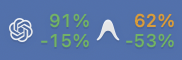
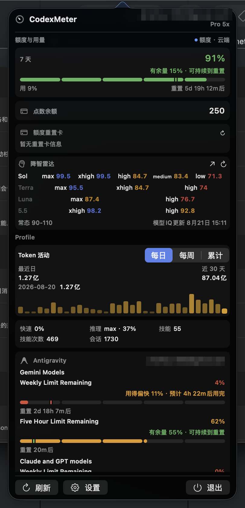
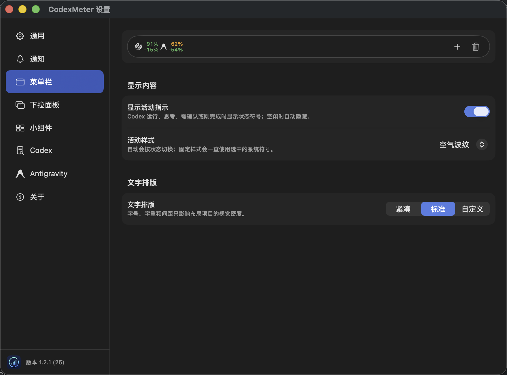
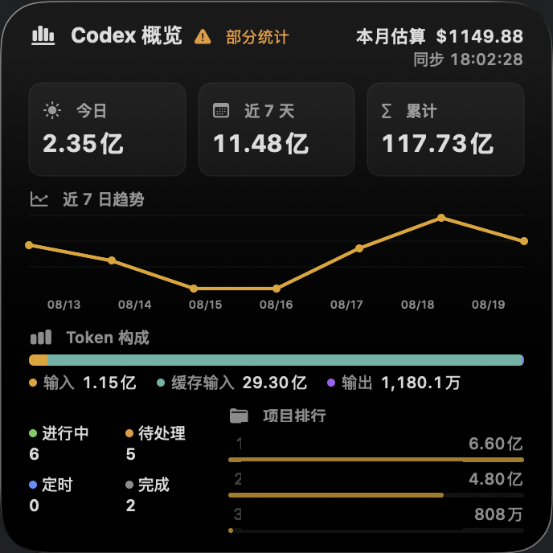
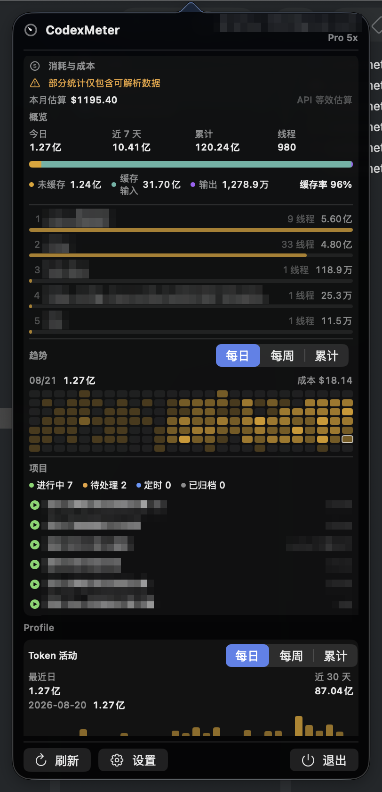

# CodexMeter

常驻 macOS 菜单栏的 Codex 用量仪表盘：把云端额度、本机 Token 活动、重置时间、使用节奏、成本估算和模型雷达集中到一个轻量面板中。

当前 README 按最新代码和 UI 更新维护。截图来自实际运行中的 CodexMeter，已去除账户标识、项目名、Token 和成本等本机操作信息；额度数字仅用于说明布局。





## 当前功能

### 菜单栏布局

- 拖动菜单栏项目调整顺序；项目可以独立显示，也可以在一个容器内上下堆叠，最多两行。

- Codex 和 Antigravity 图标保持独立，不会被错误合并到额度堆叠中。

- 可添加 5 小时、7 天、余额、重置时间、预期偏差、本机成本等项目；没有可信数据的项目会自动隐藏。

- 支持紧凑、标准、自定义三种文字排版，并可调整字号、字重、项目间距和行距。

- 支持活动指示器和“空气波纹”等指示样式，便于观察当前 Codex 会话状态。



### Codex 云端额度

- 展示 5 小时、7 天及接口返回的其他额度窗口。
- 支持额度重置卡、实时重置倒计时和按工作日刻度计算的预期消耗速度。
- 使用胶囊分段进度条区分实际剩余、理论节奏和预期偏差；工作日刻度可配置为 5 天或 7 天。
- 网络请求失败时继续展示最近一次成功同步的快照。

### 下拉面板

- 可独立开关额度、重置卡、Profile 概览、Token 活动、活动洞察和常用插件模块。
- 本机消耗与成本支持概览、趋势、项目和任务模块；趋势可以切换每日、每周和累计口径。
- 支持 26 周 Token 热力图、项目消耗排行和今日任务分类。
- Codex Radar 支持模型矩阵、模型 IQ 卡片和历史折线图，并可独立启停。

### 本机统计与成本

CodexMeter 以只读方式读取当前 `CODEX_HOME` 下的 Codex 状态库、会话索引和 rollout，聚合展示：

- 今日、近 7 天和累计 Token；缓存输入、非缓存输入和输出构成。
- 会话/线程数量、项目排行、任务状态和 Token 活动趋势。
- 按已知模型 API 价格计算的等效成本；未知模型或不完整会话会标记为部分统计，不会强行猜价。
- fork 会话去重和 Token 精度修正，避免父子会话继承用量重复计入。

更多字段、读取边界和本地文件说明见[本机统计说明](docs/1.md)。

### Antigravity

- 可选启用 Antigravity，选择全部模型或指定模型配额组。
- 支持在下拉面板和菜单栏分别显示 Antigravity 配额。
- 5 小时窗口优先用于菜单栏摘要和紧张窗口判断。
- 配额优先读取正在运行的本地 Antigravity 服务；本地服务不可用时才尝试已保存的 Google OAuth 配置。

### OpenCode Go

- 在“设置 → OpenCode Go”启用，展示官方返回的 5 小时、7 天和月额度及各自的重置时间。
- 自动读取 `OPENCODE_API_KEY`，或 `$XDG_DATA_HOME/opencode/auth.json`（默认 `~/.local/share/opencode/auth.json`）中的 `opencode-go` API 凭据；也可在设置中保存手动 Key 到系统钥匙串。
- 设置页独立管理启用与凭据；菜单栏通过“菜单栏 → + → OpenCode Go”添加图标、5 小时、7 天、月额度、自动剩余、预期偏差、用量条、重置时间和预计耗尽，与其他供应商一起拖动、堆叠和排列。
- 刷新频率沿用通用设置；请求失败时显示错误并保留本次运行中同一凭据的最近成功数据，关闭或更换凭据后清空。
- 使用 [OpenCode 官方品牌](https://opencode.ai/brand)标识的 CodexBar 单色菜单栏版本；账号、余额和费用未从当前用量 API 获取，不展示猜测值。
- 参考 [CodexBar 的 OpenCode Go 实现](https://github.com/steipete/CodexBar/tree/main/Sources/CodexBarCore/Providers/OpenCodeGo)，使用官方只读用量 API，不将本机成本估算当作账户配额。

### 小组件、通知与更新

- WidgetKit 提供额度小组件和本机统计小组件，共享主应用最近一次成功同步的安全快照。
- 小组件可配置显示窗口、重置时间、预期消耗速度、最近同步和账户摘要。
- 额度窗口归零时可发送系统通知，并支持 5 小时/7 天重置彩带庆祝效果。
- 支持登录时启动、刷新频率、明暗外观、中英文界面和诊断入口。
- 内置 Sparkle 2，默认每天检查更新，也可在“设置 → 关于 → 更新”手动检查。



## 重点界面

### 菜单栏

菜单栏只保留最重要的实时读数；Codex 与 Antigravity 可以分别配置图标、额度窗口和上下堆叠项目。


### 下拉面板

下拉面板集中展示额度、重置卡和 Codex Radar；本机 Token、项目和成本模块可按需开启。



## 安装与替换

1. 从 [GitHub Releases](https://github.com/jinsihou19/CodexMeter/releases/latest) 下载最新 Universal DMG。
2. 打开 DMG，将 `CodexMeter.app` 拖入“应用程序”，确认替换旧版本。
3. 首次启动若被 Gatekeeper 拦截，在 Finder 中右键应用并选择“打开”。

手动拖拽 DMG 时，Finder 只负责复制 App，不会执行仓库里的安装脚本。更新前请先从菜单栏退出旧版，再拖拽并确认替换；否则旧实例仍可能占用菜单栏，产生多个图标。

本机发布脚本会自动结束正在运行的 `CodexMeter`、旧版 `CodexUsage` 和 Widget 进程，等待退出后删除旧包，再安装并启动唯一的 `/Applications/CodexMeter.app`：

```bash
CODEX_PUBLISH_RELEASE=0 CODEX_INSTALL_LOCAL=1 bash script/package_release.sh
```

系统要求：macOS 15.0 或更新版本。

### 首次使用

- Codex 额度从 `CODEX_HOME/auth.json` 或 `~/.codex/auth.json` 读取现有登录状态；应用不会替你登录，也不会保存认证 token 副本。
- 本机统计需要当前用户可以读取 Codex 状态库；数据库不存在或 schema 不兼容时，网络额度仍可正常使用。
- Antigravity 为可选功能；开启后会优先探测本地服务，必要时再使用已有 Google OAuth 配置。
- 活动样式默认为“无”。在“设置 → 菜单栏”选择其他活动样式后，未安装时可点击“活动钩子”右侧的“安装”；安装完成后显示“已安装”和信任说明。无需 Python、复制脚本或手动启动服务，所有本机项目通用。

### 标识迁移

应用、Bundle ID、App Group、Widget kind 和缓存目录统一使用 CodexMeter 标识。只有当前配置为空且尚未做过选择时，应用才询问是否迁移旧版或本地偏好设置。仅点击“迁移配置”才转换旧键、复制缺失设置并在保存验证成功后清理来源，最多成功执行一次，始终保留当前配置。启动、读取、保存和刷新都不执行迁移；布局中删除的项目不会自动补回。保存失败则保留旧配置，缓存、授权和每日请求状态不参与迁移或清理。

## 数据来源与隐私

### Codex 云端额度

CodexMeter 使用本机已有 token 请求以下接口：

1. `GET https://chatgpt.com/backend-api/wham/usage`
2. `GET https://chatgpt.com/backend-api/wham/profiles/me`
3. `GET https://chatgpt.com/backend-api/wham/rate-limit-reset-credits`

token 只在内存中用于请求，不会写入 CodexMeter 的缓存、日志或 Widget 快照。网络请求失败时，应用会继续展示最近一次成功保存的快照。

### 本机统计

本机统计只读访问当前 `CODEX_HOME` 下的 `state_5.sqlite`、`session_index.jsonl`、automation 配置和数据库引用的 rollout 文件。共享快照不包含 prompt、transcript、工具输出、完整工作目录或任务标题。

菜单里的“估算成本”按已知模型的公开 API 价格计算：

```text
非缓存输入 × 输入单价 + 缓存输入 × 缓存单价 + 输出 × 输出单价
```

这是 API 等效成本估算，不是订阅账户账单；未知模型或不完整会话不会被强行猜价，界面会标记为部分统计。

价格目录来自 `https://models.dev/api.json`，24 小时刷新一次；遇到未计价模型可提前尝试刷新，重试至少间隔 15 分钟。下载不携带会话或账户信息，失败沿用最后有效缓存；价格来源、同步时间和未计价模型仅保留在统计快照中。缓存位于 `~/Library/Caches/CodexMeter/model-pricing/models-dev-v1.json`。

内置价格保护已知的历史调价日期（包括 Sol 2026-08-21 调价）。后续外部价格变动按本机首次观察到的 UTC 日期保存版本，不声称还原尚未观察到的供应商历史调价；此前无价格的新模型可补算已有日志。重新计价复用事件缓存，增加缓存写入字段后的首次升级需要重新解析日志。

Astra 支持缓存读取、缓存写入、272K 输入阈值和日志明确记录的 Fast/priority 层级；缓存写入是输入的子集，不重复计数。未记录服务层级的日志按标准价估算，不根据当前设置倒推历史 Fast 使用；未知服务层级或缺少实际使用桶单价时保持未计价。外部目录目前支持单个上下文价格阈值，多阶梯行拒绝导入。


### 其他网络数据

- Codex Radar 读取 <https://codexradar.com/current.json>，只用于模型雷达展示。
- Antigravity 额度优先读取本地服务；本地服务不可用时才尝试已有 Google OAuth 配置。
- 活动 Hook 只写入轻量状态，不包含 prompt、transcript 或工具输出。

## 自动更新

Sparkle 默认每天检查一次更新，也可以在“设置 → 关于 → 更新”中手动检查。

- 更新源：<https://jinsihou19.github.io/CodexMeter/appcast.xml>
- 安装包：GitHub Releases
- 校验：Sparkle EdDSA 签名

更新弹窗会直接展示本次发布的分类改动，并附完整变更记录链接；内容与 GitHub Release 共用同一份说明，随打包自动生成。

当前 Release 使用 ad-hoc 签名，适合本机和小范围分发；面向公众长期分发时建议增加 Developer ID 签名与 Apple 公证。

## 开发

项目使用 Xcode、Swift 6、AppKit、SwiftUI 与 WidgetKit。

```bash
xcodebuild -project CodexMeter.xcodeproj -scheme CodexMeter -destination 'platform=macOS' test CODE_SIGNING_ALLOWED=NO
xcodebuild -project CodexMeter.xcodeproj -scheme CodexMeter -destination 'platform=macOS' build CODE_SIGNING_ALLOWED=NO
```

运行真实用量接口集成测试：

```bash
xcodebuild -project CodexMeter.xcodeproj -scheme CodexMeter -destination 'platform=macOS' test CODE_SIGNING_ALLOWED=NO CODEX_USAGE_RUN_INTEGRATION=1
```

## 打包与发布

推荐在 GitHub 仓库的 Actions 页面手动运行“打包并发布 CodexMeter”。工作流会自动选择递增构建号、构建 Universal DMG、创建 Release，并把已签名的 `appcast.xml` 部署到 Pages。首次使用前，需要在仓库 Actions Secret 中配置 `SPARKLE_PRIVATE_KEY`。

本机发布需要工作区已经提交并推送，且本机已安装、登录 [GitHub CLI](https://cli.github.com/)：

```bash
bash script/package_release.sh
```

需要指定新语义版本时，设置 `CODEX_RELEASE_VERSION` 环境变量，格式为 `MAJOR.MINOR.PATCH`。

发布产物命名为 `CodexMeter-<version>-<build>-universal.dmg`。语义版本使用 `MAJOR.MINOR.PATCH`，构建号单调递增；只有构建、安装和远程发布全部成功后才推进下一构建号。

## Codex Hook

在“设置 → 菜单栏”选择非“无”的活动样式，再点击“活动钩子”右侧的“安装”。应用把原生入口合并到 `CODEX_HOME/hooks.json`（默认 `~/.codex/hooks.json`），保留其他 Hook，并在首次改写前备份到同目录的 `hooks.json.codexmeter-backup`。检测全部活动事件完整配置后，按钮自动替换成“已安装”；移动 App 或条目缺失时会重新显示安装按钮。选择“无”隐藏活动图标与安装行，保留已安装的 Hook。

配置后需要在 Codex 的 `/hooks → 来自配置 → 用户配置` 中审核并信任活动 Hook，再开始新回合。需要的 10 项是 `SessionStart`、`UserPromptSubmit`、`PreToolUse`、`PermissionRequest`、`PostToolUse`、`PreCompact`、`PostCompact`、`Stop`、`Interrupt` 和 `SessionEnd`；它们的命令均包含 `--codexmeter-activity-hook`，状态说明统一为“CodexMeter 活动指示 · 事件名”。“已安装”只表示配置完整，不表示已获 Codex 信任。应用不修改 Codex 的信任设置。

为兼容更名前的安装，应用在系统允许访问时也读取旧版 App Group 目录的活动文件，按会话取新旧文件中最新事件，避免同一回合重复显示。旧目录被系统拒绝时，使用内置全局 Hook 写入新的用户支持目录即可恢复活动显示。

仓库保留可选的项目级桥接，它只转交已安装的原生处理器，所有入口共用同一把写入锁；不再由 Python 独立写状态。已使用全局入口的项目无需重复配置：

- `.codex/hooks.json`
- `.codex/hooks/codex_activity.py`

活动状态写入 `~/Library/Application Support/CodexMeter/codex-activity.json`，应用聚合显示当前 Codex 会话状态。这份文件只供菜单栏使用，采用主应用自己的用户目录，避免 ad-hoc 主进程因没有 App Group 授权而无法读取 Hook 写入的状态。现有原生 Hook 的命令保持不变，升级 App 即可使用新目录。它是本地会话活动指示，不是 OpenAI 账单或计费接口。

### 活动状态与颜色

- 持久主会话的当前回合才参与汇总；缺少可核对日志身份的临时请求和子代理事件不会单独点亮菜单栏。
- 运行、思考和整理上下文统一为绿色；等待审批或提问回复为橙色；工具失败为红色；完成只显示静止的绿色勾选，3 秒后隐藏。空闲不显示。
- 同步与异步提问均跟踪到对应回复，异步工具返回 `accepted` 或并行工具结束不会提前清除橙色；明确等待用户时不套用运行中的 60 秒异常超时。活动文件只保存问题编号和审批工具身份，不保存问题及答案正文。
- 只有提交新回合才能启动活动；同回合重复提交不会重置状态。`Stop` 后保留结束记录以拒绝迟到事件，旧回合的事件也不能覆盖新回合。
- `Interrupt` 和 `SessionEnd` 立即清理显示。轮询同时核对当前回合的日志尾部生命周期标记，结束 Hook 未执行时也能收起已完成或中断的回合；只读取有限大小的日志头尾，不保存正文副本。未知日志结构仍由 Hook 和 60 秒异常兜底处理。
- 从旧安装升级后，可在“活动钩子”行安装补全 `Interrupt` 与 `SessionEnd`，并在 Codex `/hooks → 用户配置` 中信任这两项；原有相同命令的信任由 Codex 保留管理。
